# Sidequest - Quick Games in Orca

Refresh your mind with a quick game while your agents work.

A home for small games inside [Orca](https://onorca.dev), with one compact sidebar, a quick picker, and separate saved progress. Take a break and pick up where you left off whenever you return.

[](https://onorca.dev) [](#previews) [](LICENSE)

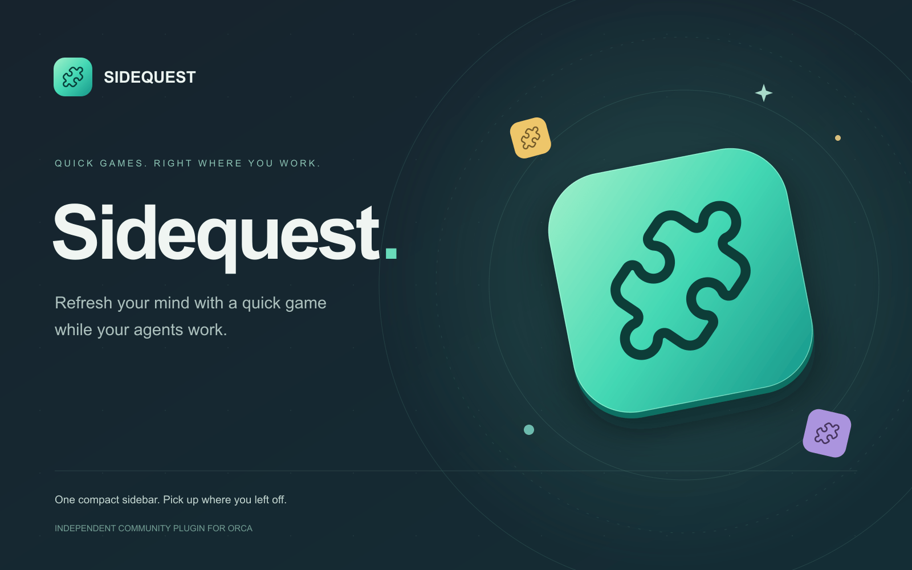

## Install

Requires **Orca desktop 1.4.248 or newer**.

1. Open **Settings → Plugins**.
2. Choose **Add plugin → From a Git URL…** and enter:

   ```text
   https://github.com/faisalmuhammad/orca-sidequest#v0.3.0
   ```

   Keep `#v0.3.0` at the end. Orca requires a release tag or commit hash to install from Git.
3. Review and approve the requested access: a **sandboxed panel** and **plugin-owned storage** for saved progress.
4. Select **Sidequest** using the puzzle icon in the right sidebar, then pick a game. **All games** returns to the picker; the selector switches games directly.

All runtime assets are included. Installation requires no Node.js, dependencies, or build step.

## Games

Pick a quick game from the library. Each keeps its own progress, and the artwork below matches the cards in Sidequest’s main panel.

<table>
  <tr>
    <td width="33%" align="center">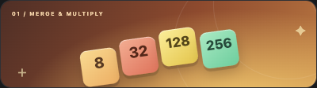<br><strong>2048</strong><br><sub>Find your flow. Chase the next merge.</sub></td>
    <td width="33%" align="center">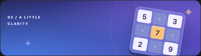<br><strong>Sudoku</strong><br><sub>Clear the grid, one number at a time.</sub></td>
    <td width="33%" align="center">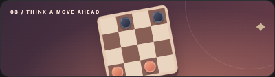<br><strong>Checkers</strong><br><sub>A small board. A new strategy.</sub></td>
  </tr>
  <tr>
    <td align="center">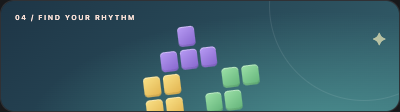<br><strong>Falling Blocks</strong><br><sub>Fit the pieces. Clear the lines.</sub></td>
    <td align="center"><br><strong>Memory</strong><br><sub>A familiar face, twice.</sub></td>
    <td align="center">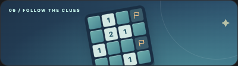<br><strong>Minesweeper</strong><br><sub>Trust the numbers. Find the safe path.</sub></td>
  </tr>
  <tr>
    <td align="center">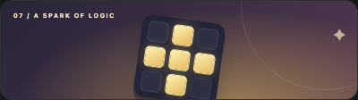<br><strong>Lights Out</strong><br><sub>Clear your mind. Turn down the lights.</sub></td>
    <td align="center">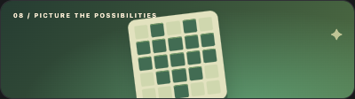<br><strong>Nonograms</strong><br><sub>Follow the clues. Reveal a picture.</sub></td>
    <td align="center"><br><strong>Codebreaker</strong><br><sub>Read the feedback. Crack the sequence.</sub></td>
  </tr>
  <tr>
    <td align="center"><br><strong>Sliding Puzzle</strong><br><sub>One empty space. A little order.</sub></td>
    <td align="center"><br><strong>Connect Four</strong><br><sub>Think ahead. Connect your next four.</sub></td>
    <td align="center">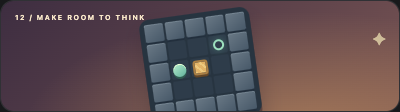<br><strong>Sokoban</strong><br><sub>Make room. Deliver every crate.</sub></td>
  </tr>
</table>

## Previews

| Dark | Light |
| --- | --- |
| 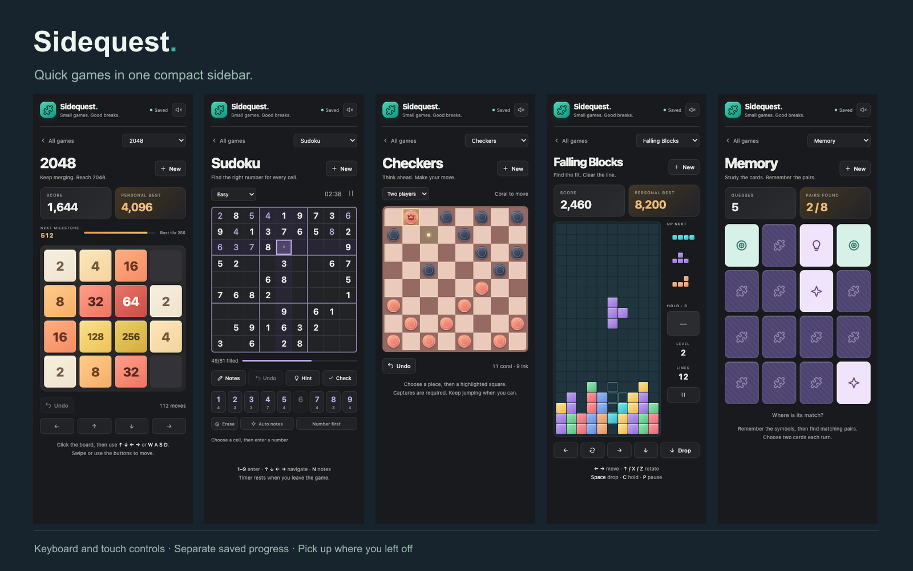 | 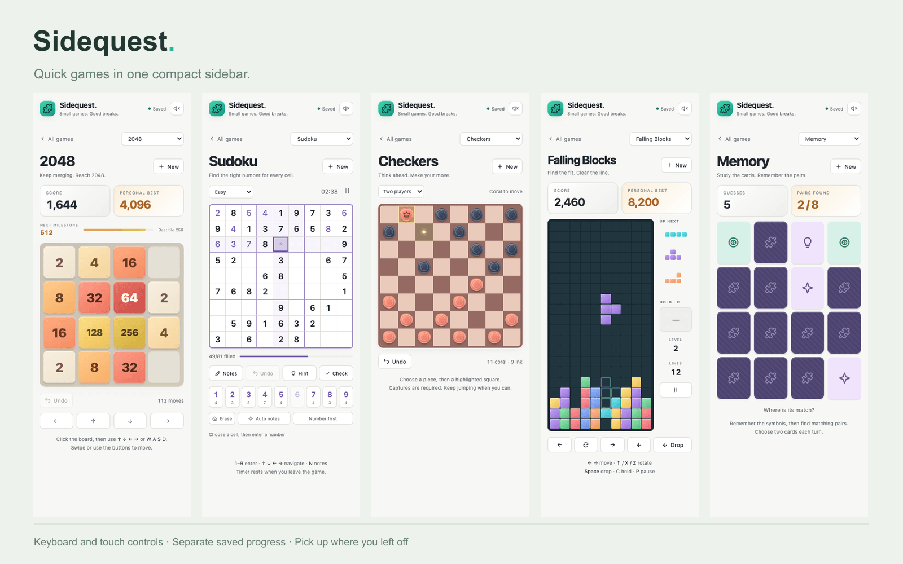 |

The previews combine **actual interface captures from Orca’s embedded browser**, using sample saved progress in a standalone preview. The cover is vector artwork using Sidequest’s shared puzzle identity. The local preview and native plugin keep separate save data.

## Features

| Feature | Behavior |
| --- | --- |
| One game picker | Switch games inside the same sidebar |
| Saved progress | Each game keeps its own round and personal records |
| Keyboard and touch | Controls and shortcuts appear within each game |
| Optional sound | Turn sound on or off using the speaker button; your choice is saved |
| Thoughtful motion | Smooth transitions, with reduced-motion support |
| Light and dark | Styling follows Orca’s appearance |
| Library views | Switch between compact tiles and expanded cards with the header button beside sound; your choice is saved |
| Sidebar layout | Works in narrow sidebars; real-time play pauses when you leave |

The status-bar puzzle icon toggles the right sidebar. If another panel is selected, choose Sidequest’s puzzle tab. Orca’s current plugin API cannot select a specific panel or report which panel is active, so the status-bar icon cannot reflect Sidequest’s active state yet.

## Progress and access

Games save automatically. Reopening resumes your selection, and starting a new game asks before replacing a round in progress.

The header shows **Saved**, **Saving**, **Device save** (Orca storage is unavailable), or **Not saved**. Writes are serialized, with a synchronous device journal to recover recent progress if the panel closes during a save. Invalid game data resets independently.

The only capability is **storage:own**, for private game saves. Runtime code runs in Orca’s isolated panel, without a Node worker or network requests. Sound starts after a click or key press.

<details>
<summary>Local development and validation</summary>

To work on the plugin locally, clone this repository and add its root through **Settings → Plugins → Development folders…**. Approve the sandboxed panel and plugin-owned storage, then select Sidequest’s puzzle tab.

Plain HTML, CSS, and JavaScript modules, with no build step. Requires Node.js 22+ for tooling.

~~~sh
npm test
orca plugin test . --json
orca plugin validate . --json
orca plugin check . --json
~~~

For a standalone preview:

~~~sh
npm run preview
~~~

Open http://127.0.0.1:4318. Set `SIDEQUEST_PREVIEW_PORT` to change the port. With the preview running and Orca open, run `npm run test:browser` to check real input, game switching, save recovery, narrow layouts, and audio output. Diagnostic captures are saved under `.orca/shots/`.

Game rules live in `panel/games/`; panel modules handle rendering and controls; `panel/storage.mjs` handles persistence. Keep new games self-contained, keyboard and touch accessible, compact, and dependency-free. Register their creator and validator, add a picker entry, and test rules, save recovery, and interaction.

Validated on macOS with Orca **1.4.250**: **75** rules, sound, and save tests; browser checks at **320px** and **240px**, including the full Sokoban campaign; Orca validation/checks; and native panel captures without runtime errors.

The manifest references release images in `assets/`. Vector sources and original captures are retained under `assets/source/`. Run `scripts/release-art.mjs` to render artwork and `scripts/release-shots.mjs` with the preview running to capture the interface. These optional image tools use Sharp. Install it locally with `npm install --no-save --package-lock=false sharp`, or set `SHARP_MODULE` to an installed ESM module. Sharp is not a runtime dependency.

Run `node scripts/release-gallery.mjs` with the preview running and Orca open to refresh the README’s game artwork in `assets/games/`. It captures the panel’s own card previews, restores the preview’s previous saved progress, and needs no image dependencies.

Exclude `node_modules/` and `.orca/` from Git and release uploads.

</details>

## Attribution and license

An independent community plugin, maintained by [faisalmuhammad](https://github.com/faisalmuhammad). Sidequest is not affiliated with Orca.

Plugin code and original artwork use [MIT](LICENSE). The shared puzzle glyph comes from [Lucide](https://lucide.dev), matching Orca’s built-in icon. Its ISC license and upstream notices are preserved in [LICENSE-LUCIDE](LICENSE-LUCIDE).
